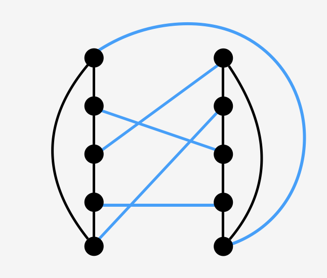

> **Question**: Last weekend I attended a pilot competition for MATHCOUNTS 345, where 3rd, 4th, and 5th graders spent several hours doing math together. While the judges finished scoring, the kids played “Don’t Make a Triangle,” a variant of the game Sim. In the game, $N$ points are arranged on a circle. Students take turns drawing chords that connect two points. Once a chord is drawn, it cannot be drawn again by either player. The first player to “draw a triangle,” meaning they draw the third side of a triangle whose three vertices are among the $N$ points, loses. (Note: There may be triangles whose vertices are intersections of chords inside the circle. Drawing any of these triangles doesn’t count as losing.) 
>
> This got some of the kids wondering: For $N = 10$, what is the greatest number of chords that can be drawn such that there are no triangles?
>
> **Extra Credit**: We already said a player loses who first draws a triangle, which is a loop of three chords. Suppose instead that a player loses when they are the first to draw a loop of three distinct chords (i.e., a triangle) or four distinct chords. For $N = 10$, what is the greatest number of chords that can be drawn such that there are no loops of three chords or four chords?

<!--more-->

([Fiddler on the Proof](https://thefiddler.substack.com/p/dont-make-a-triangle-or-a-loop))

## Solution

We'll answer both parts with the same kind of argument.
First, we will find the upper bound on the degree of a node and then we'll show that it's possible to saturate.

In the following, we'll calculate the bounds while making the assumption that all nodes have the same degree, then we'll show why this must be the case.

### Standard credit

If a graph has no 3-loops then if we pick some node $o$ and look at its neighbors, no two of them can be connected to each other.

So, let's take a specific neighbor $j$ and look at its neighbors that aren't $o$ itself. 
This is a list of $(d-1)$ nodes.
$o$ also has $(d-1)$ neighbors that aren't $j$, which we can add to the list.

<!-- If there are more than $(n-2)$ distinct nodes in this list, then two of $o$'s neighbors must be neighbors and therefore form a triangle.  -->

Because the whole graph has just $n$ nodes, there are only $n-2$ nodes besides $o$ and $j$. 
For the graph to be triangle-free, $o$ and $j$ cannot share any common neighbors.
So, the greatest their combined neighbor count can be is $n-2$.
So $2(d-1) \leq n-2, $ or $d \leq \tfrac12 n$, so the degree $d$ for a node can be at most $\tfrac12 n$. 
If that bound saturates for each node, then the total number of edges would be 

$$ \frac12 nd = \frac{n^2}{4} $$

which is $25$ for our problem.

To see that it's always possible, let's divide the nodes into two equal groups and connect every node in one to every node in the other. 
This would make $5^2$ edges, and any additional edge would have to connect two nodes that are already in the same group.
But since each node in one group is connected to each node in the other, this would form a triangle.

So, $25$ is the realizable max.

### Extra credit

Now we are considering graphs without 3- and 4-loops so the set of relevant nodes is direct neighbors plus next-nearest neighbors.

For any node $o$, the number of direct neighbors is just $d$ and the number of next nearest neighbors is $d(d-1)$ for a total of $d + d(d-1) = d^2.$ 
If the size of this set is greater than $(n-1)$ then we have a 3- or a 4-loop, so $ d^2 \leq n-1 $ and $d$ is at most $\sqrt{n-1}.$
This makes the total number of edges in the graph $\tfrac12 nd$ or

$$ \frac12 n \sqrt{n-1}. $$

Plugging in $n=10$, we get a maximum edge count of $\tfrac12\cdot 10 \cdot\sqrt{10-1} = 15.$

This upper bound can also be saturated, as seen in the graph below

{:width="450 px" class="image-centered" caption="A graph with 10 nodes, each of degree 3, that contains no 3- or 4-loops, rendered beautifully using Apple Keynote."}

### Why are the graphs regular?

Without assuming uniform degree, the triangle free condition becomes

$$ d_o + d_j \leq n. $$

Since this holds for any connected pair $o$ and $j$, we can sum it over all edges

$$ 
	\begin{align}
		\sum_\text{edges} d_o + d_j &\leq \sum_\text{edges} n \\
		\sum_\ell d_\ell^2 &\leq n\lvert E\rvert = \frac12 n\sum_\ell d_\ell
	\end{align}
$$

The reason for the left side is that $d_o$ will appear in as many sum terms as edges it appears in, which is just $d_o,$ so we end up with the squared sum of degrees.

The sum $\sum_\ell d_\ell$ is bounded above by $\sqrt{n}\sqrt{\sum_\ell d_\ell^2}$.
To see this, think of the list of degrees as a vector $\mathbf{d}$ and take its dot product with the vector of all ones $\mathbf{1}$, then apply Cauchy-Schwarz inequality ($\mathbf{a}\cdot\mathbf{b} \leq \lvert\mathbf{a}\rvert\lvert\mathbf{b}\rvert$) .

Squaring both sides we get

$$ \left(\sum_\ell d_\ell\right)^2 = 4\lvert E\rvert^2 \leq n\sum_\ell d_\ell^2 $$

and putting it together with the first inequality, we get

$$ 
	\begin{align}
		4\lvert E\rvert^2 &\leq n\sum_\ell d_\ell^2 \leq n^2\lvert E\rvert \\
		\lvert E\rvert &\leq \frac14 n^2
	\end{align}
$$

Now the question is, what is required for this bound to saturate?
Both of the inequalities have to saturate of course. 
Tracing back through the argument, the first one saturates when the Cauchy-Schwarz inequality does, when $\mathbf{d}$ is parallel to $\mathbf{1}$, i.e. when every degree is the same.
The second inequality saturates when the triangle-free condition saturates, telling us that $2d = n$ or $d = \tfrac12 n.$

So, the assumption of uniform degree is justified.

### What about 3- or 4- loops?

The same kind of analysis holds for graphs with no 3- or 4-loops.
There, the condition is that the total number of nearest and next nearest neighbors cannot exceed $n-1$, so

$$ d_o + \sum_{j \in \text{neighbors of $o$}} \left(d_j - 1\right) \leq n-1 $$

or

$$ \sum_{j \in \text{neighbors of $o$}} d_j \leq n-1. $$

This holds for all nodes $o$, and summing over them we get

$$ \sum_\ell d_\ell^2 \leq n(n-1). $$

Doing the same as above we get

$$ \frac{4\lvert E\rvert^2}{n} \leq \sum_\ell d_\ell^2 \leq n(n-1) $$

which leads to 

$$ \lvert E\rvert \leq \frac12 n\sqrt{n-1}. $$

Saturating again requires uniform $d_\ell$ and saturating the no 3- or 4-loops condition.
That second condition tells us that adding up the degrees of all neighbors of node $o$ mustn't be greater than $(n-1)$, or $d^2 \leq n-1.$

<!-- if we're going to have a graph with no 3-loops, then if we look at the neighbors of the neighbors of any given node, we can't have any node appear twice. 
if at least one did, then we'd have a 3-loop. 

$$ \deg_i + \sum_{j\in N(i)} \deg_j - \deg_i = \sum_{j\in N(i)} \deg_j. $$

the most this can be without having a forced triangle is $(n-1)$ -->

<!-- we will count the total number of edges in two ways:
- by adding up the degrees of neighbors (and neighbors of neighbors for the EC)
- by counting  -->

 
